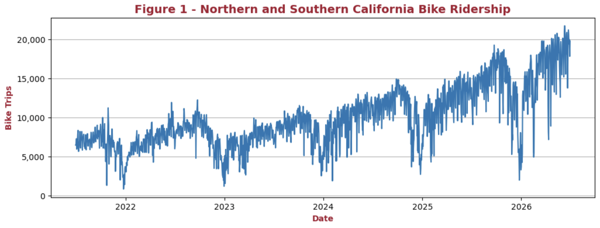
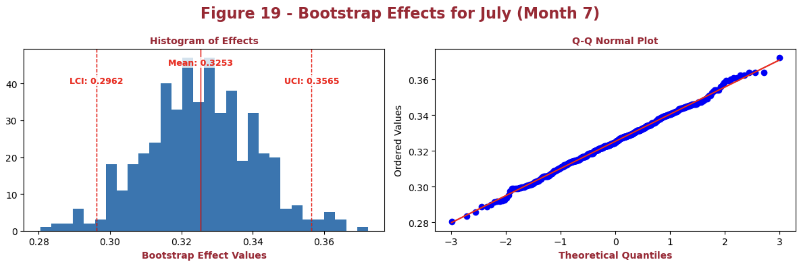
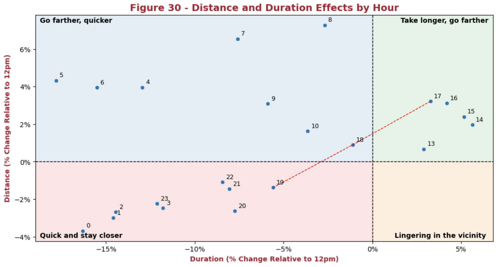
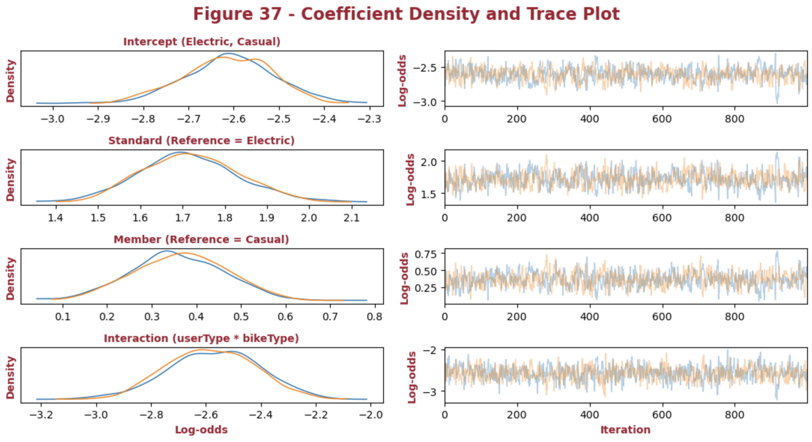

# 🚲 A Study of 5 Years of Bike-Share Ridership in California (2022 – 2026)

> **How do Californians ride, and how does that differ from one region to the next?**
> This project works through five years of bike-share trip data to uncover seasonal rhythms, regional differences, and the factors that drive ridership, using a full toolkit of classical and Bayesian statistical inference.

Time Series                |  Bootstrapping
:-------------------------:|:-------------------------:
  |  

Generalized Linear Model   |  Markov Chain Monte Carlo 
:-------------------------:|:-------------------------:
  |  
---

## 📖 Overview

Bike-share systems generate rich, high-volume data about how people move through cities. This repository contains a single end-to-end Jupyter notebook that takes raw trip records from 2022 to 2026 and turns them into statistically grounded answers about rider behavior across California.

Rather than relying on one modeling approach, the notebook deliberately compares **frequentist, resampling-based, and Bayesian** techniques on the same data. The goal is both to answer the questions and to show how each method's assumptions, strengths, and trade-offs play out in practice.

### Questions explored

- How do ridership patterns change across seasons, days of the week, and times of day?
- How do regions of California differ in trip volume and trip duration?
- Which factors have the strongest effect on ridership, and do those effects vary by region (interactions)?
- How much uncertainty surrounds our estimates, and how does it change depending on the method used?

---

## 🧰 Topics Covered

| # | Topic | What it involves |
|---|-------|------------------|
| 1 | **Data Processing & Cleaning** | Handling missing values, outliers, inconsistent records, and type conversions |
| 2 | **Feature Engineering** | Building temporal, regional, and trip-level predictors from raw fields |
| 3 | **Exploratory Data Analysis** | Visualizing distributions, trends, and regional contrasts |
| 4 | **OLS Models** | Baseline linear regression and diagnostics |
| 5 | **GLMs** | Poisson, Negative Binomial, and Gamma families for count and positive-continuous outcomes |
| 6 | **Bootstrapping Coefficients** | Resampling-based confidence intervals without strict distributional assumptions |
| 7 | **Main Effects & Interactions** | Interpreting how predictors act alone and in combination |
| 8 | **Markov Chain Monte Carlo (MCMC)** | Bayesian posterior sampling for model parameters |
| 9 | **Beta-Bernoulli Conjugate Model** | Closed-form Bayesian updating for binary outcomes |

---

## 🔬 Methodology at a Glance

```
Raw trip data  →  Cleaning  →  Feature engineering  →  EDA
                                                         │
        ┌────────────────────────────────────────────────┤
        ▼                         ▼                       ▼
   OLS baseline          GLMs (Poisson, NB, Gamma)   Bayesian (MCMC, Beta-Bernoulli)
        │                         │                       │
        └──────────── Bootstrapped uncertainty ───────────┘
                                  ▼
                 Interpretation: main effects & interactions
```

**Why these model families?**

- **OLS** provides an interpretable baseline.
- **Poisson / Negative Binomial** are suited to trip *counts*, with Negative Binomial handling the overdispersion that count data often shows.
- **Gamma** fits positive, right-skewed outcomes such as trip *speed*.
- **Bootstrapping** gives robust uncertainty estimates when classical assumptions are shaky.
- **MCMC and conjugate models** offer a Bayesian view, with full posterior distributions instead of single point estimates.

---

## 🚀 Getting Started

### Prerequisites

- Python 3.11.18
- JupyterLab

### Installation

```bash
# (Recommended) create a virtual environment
micromamba create -f inference.yml
micromamba activate inference
```

### Run the notebook

```bash
jupyter lab
```

Open the notebook and run the cells from top to bottom.

---

## 📁 Repository Structure

```
├── pictures/            # Figures used in this README and the notebook
├── library/             # Helper functions and custom CSS styling for the notebook
├── sample_data/         # Sample datasets (100 observations per file) for testing the environment
├── <notebook>.ipynb     # Main analysis notebook
├── inference.yml        # Python dependencies
└── README.md
```

---

## 💡 Key Takeaways

> *This analysis used six complementary statistical approaches to understand California bike-share usage. Using several modeling frameworks let each outcome be matched to a distribution that fit its structure, and the diagnostics showed where each model was adequate and where it fell short.*
>
> - **Ridership is growing quickly**. By 2026, ridership was roughly double the 2022 baseline, with demand peaking in the PM commute block and bottoming out overnight.
> - **The July dip is not a San Francisco story**. We hypothesized that SF’s foggy summers drove the decline, but the bootstrap showed that nearly every region fell from June to July, and North Hollywood fell the most (39%) while San Francisco fell 19%. The decline is statewide, though without weather data we cannot identify its cause.
> - **Special events drive the outliers**. CicLAvia street closures, New Year’s night, and Día de los Muertos accounted for many of the most influential observations. Labeling local events in the data would likely improve future models.
> - **Who rides, and on what, shapes how they ride**. Members take shorter, faster trips that stay closer to their origin, while casual riders and holiday riders go longer and farther. Electric bikes are about 21% faster than standard bikes.
> - **Round trips depend on the combination of bike and rider type**. Casual users on standard bikes had about 5.6 times the odds of a round trip compared with casual users on electric bikes, while for members the pattern reversed. Overall, round trips were only about 11% of trips.
> - **Popular station pairs behave very differently by region**. The 2026 posterior probability of a rider returning a bike to the paired station ranged from 8.6% in San Francisco to 53.7% in North Hollywood, and it has been trending in different directions across regions.

---

## 🤝 Contributing

Suggestions and improvements are welcome. Feel free to open an issue or submit a pull request.

## 📬 Contact

Questions or feedback? Reach out via GitHub or open an issue on this repository.

---

<p align="center"><i>If you found this project useful, consider giving it a ⭐</i></p>
